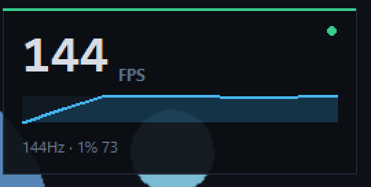

# FPS 悬浮窗 + 卡顿基线测试

两个 Windows 小工具，纯 Python 标准库实现（需 Python 3.10+）：

| 工具 | 作用 |
| --- | --- |
| `fps_overlay.pyw` | 桌面右上角悬浮面板，实时显示屏幕帧率 / 帧时间 / 1% Low |
| `lag-bench.py` | A/B 对比：开某个软件前后，电脑到底有没有变卡 |

双击 `start-fps-overlay.bat` 启动悬浮窗；退出按 `Ctrl+Alt+Q`。



## 30 秒上手

1. 双击 `start-fps-overlay.bat`，面板出现在屏幕右上角。
2. 默认**鼠标穿透**，点不到它，不会挡住游戏和桌面操作。
3. 想换位置：按 `Ctrl+Alt+L` 解锁 → 拖动 → 再按一次 `Ctrl+Alt+L` 锁定（也可以右键点菜单）。
4. 想调大小：`Ctrl+Alt+1/2/3`。

## 热键（全局，按住 Ctrl+Alt 再按）

| 组合 | 作用 |
| --- | --- |
| `Ctrl+Alt+F` | 显示 / 隐藏 |
| `Ctrl+Alt+L` | 锁定 / 解锁（解锁后能拖动、右键菜单） |
| `Ctrl+Alt+1/2/3` | 小号 / 中号 / 大号 |
| `Ctrl+Alt+M` | 主显示切换：帧率 FPS → 帧时间 MS → 1% Low |
| `Ctrl+Alt+Q` | 退出 |

## 面板怎么读

```
┌──────────────────────────────┐
│  143 FPS              ●      │  大数字：最近 1 秒的帧率
│  ▁▂▃▄▅▆▇▇▆▅▄▃▂▁▂▃▄▅▆▇      │  细线：最近 30 秒走势
│  144Hz · 1% 128 · msedge     │  刷新率 · 1% Low · 前台程序
└──────────────────────────────┘
```

- 右上角圆点：绿色 = 画面在更新，灰色 = 静止，黄色 = 显示模式切换后重连中，红色 = 桌面复制不可用。
- 底部 `1% 128` 是 1% Low（最差 1% 帧对应的帧率），看卡顿比平均值更有用。
- 前台程序名太长时会自动省略，不会顶出面板。

## 它到底测的是什么

程序用 **DXGI Desktop Duplication** 订阅桌面合成器，每来一帧只读走 `LastPresentTime` 时间戳，**不复制画面像素**，所以开销很低。它统计的是"屏幕上真正被合成显示出来的帧"：

- 游戏跑 144 fps、屏幕 144Hz → 显示 ~144
- 游戏锁 60 fps → 显示 ~60
- 视频/动画 → 显示片源的实际更新率
- 桌面完全静止 → 数字很低（屏幕确实没在刷新，这是真实情况）

它**不是**显卡的渲染帧数：比如游戏渲染 300 fps 但屏幕只有 144Hz，这里显示 144。要拿显卡渲染帧数需要 ETW/PresentMon 那一类需要管理员权限的钩子。

## 卡顿基线测试：lag-bench.py

"开这个软件会不会让电脑卡？"——平均值看不出来，尾巴才看得出来。

```bat
python lag-bench.py --run "C:\Path\App.exe"          :: 自动启动被测软件再采样
python lag-bench.py --run "app.exe" --args "-foo" --kill
python lag-bench.py                                   :: 手动：基线结束后按回车，你去启动软件
python lag-bench.py --motion --out report.md          :: 保证屏幕有动画 + 输出 Markdown 报告
```

流程：先测 20 秒基线 → 启动被测软件（预热 3 秒）→ 再测 20 秒 → 输出对比表。

采集的 6 类指标：

| 指标 | 抓的是什么卡顿 |
| --- | --- |
| 帧时间 p50/p99、长帧次数 | 画面顿挫（平均帧率看不出来的那种） |
| 调度抖动（Sleep 1ms 的超时） | 系统忙不忙，线程还能不能按时跑 |
| 窗口响应（给前台窗口发 WM_NULL 的往返） | "点一下多久才有反应" |
| CPU / DPC 时间 | 占用高不高、驱动层有没有插队 |
| 磁盘队列 / 单次 IO | 开软件时磁盘打满 = 全系统顿 |
| 硬缺页 / 可用内存 | 内存不够在换页 |

判定用的是**相对变化**，不是绝对阈值：p99 比基线涨 1.5 倍以上、抖动 p99 涨 3 倍且超过 5ms、长帧翻倍、磁盘队列翻倍等才会报"变慢"。

注意：

- 帧率和窗口响应需要**屏幕解锁、且在动**；锁屏时会显示"不可用"，其余指标照常。
- 桌面复制同时只能被一个进程持有：跑 lag-bench 时请先退出 FPS 悬浮窗。
- 单次结果别当真，重复 3 次看中位数。

## 已知限制

- **独占全屏（Exclusive Full Screen）抓不到**：游戏设置里改成"无边框窗口 / 无边框全屏"即可。切换显示模式后会显示 `--` 并在 1 秒内自动重连。
- 远程桌面 / 某些虚拟显示驱动下桌面复制不可用，会一直显示 `--`。
- 多显示器只统计主显示器（输出 0）。
- 热键是固定组合，暂不支持自定义。

## 资源占用（本机实测：2560×1440 @144Hz）

| 项目 | 数值 |
| --- | --- |
| 常驻 CPU | ~2.2%（采样线程本身 0.4%） |
| 内存 | ~60 MB |

## 配置文件

位置：`%APPDATA%\FpsOverlay\config.json`，保存位置、大小、透明度、显示模式。
删掉这个文件就恢复默认（右上角、中号、帧率模式）。

## 自检

```bat
python fps_overlay.pyw --selftest
```

跑 10 秒，只打印采样结果、不显示窗口，用来确认当前环境能不能抓到帧。

## 开机自启（可选）

按 `Win+R` 输入 `shell:startup` 回车，把 `start-fps-overlay.bat` 的快捷方式丢进去即可。

## 文件说明

| 文件 | 作用 |
| --- | --- |
| `fps_overlay.pyw` | 悬浮窗主程序（双击无控制台窗口） |
| `lag-bench.py` | 卡顿 A/B 基线测试脚本 |
| `start-fps-overlay.bat` | 悬浮窗启动器，自动挑 `pythonw` 或 `python` |
| `preview.png` | 面板预览图 |
